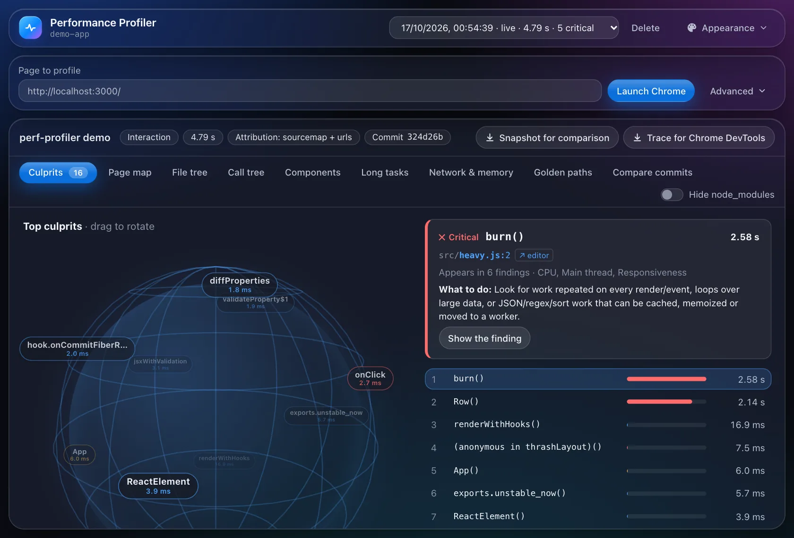

# @progen-labs/spectra

**Find out which file, which function and which component makes your frontend slow — automatically.**

Spectra is a CLI and dashboard that profiles a frontend build through the Chrome DevTools Protocol
(tracing + CPU sampling) plus a small in-page probe for component re-renders and Web Vitals. Run one
command and it starts your dev server, auto-discovers the actionable elements on the page, drives a set
of **golden-path journeys**, records each one, and reports a ranked list of culprits — each with the
exact function, file and line, the evidence, and a suggested fix.

Deep component-level attribution for **React, Next.js, Vue and Angular** (component names, render counts
and per-component render/change-detection time; source files too, where the framework exposes them). For
**Svelte and any other build**, a source-mapped generic profile still pinpoints the slow files and
functions. A [Progen Labs](https://github.com/progen-labs) project — independent, open source, no
telemetry, no account required.

**Watch the demo (2½ minutes):** [progen-labs.github.io/website/#spectra/demo](https://progen-labs.github.io/website/#spectra/demo).

**Documentation:** the full guide, with annotated screenshots of every screen, is at
[progen-labs.github.io/website](https://progen-labs.github.io/website/#spectra/docs/introduction).

## Install

```bash
npm install --save-dev @progen-labs/spectra
```

Requirements: **Node 18+** and a local **Chrome / Chromium / Edge** (Spectra drives your installed
browser; it does not download one). If it can't find Chrome, set `CHROME_PATH` to the executable.

## Quick start

From the root of your project:

```bash
npx spectra performance
```

With no `--url`, Spectra:

1. detects your framework and starts your dev server (`npm run dev`/`start`/`serve`),
2. records a baseline page load,
3. auto-discovers the actionable elements (links, buttons, inputs, forms),
4. synthesizes and runs **golden-path journeys** — safely (see below),
5. prints a performance matrix and saves a report per journey, then stops the server.

```
#  Golden path            Result    TBT    LCP  LongT  Top finding
—  Initial page load      PASS      0ms  128ms      0  [warning] main chunk served uncompressed
1  Click "Pricing"        PASS      0ms      —      0  [warning] Large DOM: 2,139 nodes
2  Click "Folders"        PASS      0ms      —      0  [critical] TreeNode re-rendered 1100× (96% wasted)
...
Automation: 8/8 golden paths passed.
```

Then open the visual dashboard — ranked culprits, React re-renders, long tasks, the golden-path matrix,
**PDF export** and **commit-to-commit compare**:

```bash
npx spectra dashboard --open
```



A [tour of the dashboard](https://progen-labs.github.io/website/#spectra/docs/dashboard), with every part
labelled, is in the docs.

## Commands

```
spectra performance [options]            Golden-path evaluation (default)
spectra performance --quick              One page-load profile (about 15 s)
spectra compare <before> <after>         Did it get faster? Noise-aware before/after
spectra reports                          List saved reports
spectra mcp [--project <dir>]            MCP server for AI tools (stdio)
spectra dashboard [--port N] [--open]    Open the dashboard UI
spectra --help                           Full option list
spectra --version
```

**`performance` options**

| Option | Description |
| --- | --- |
| `--url <page>` | Evaluate an already-running page; skips self-boot |
| `--paths <n>` | Max golden paths to run (default 12) |
| `--command "<cmd>"` | Override the dev-server command |
| `--boot-timeout <s>` | How long to wait for the dev server (default 60) |
| `--headed` | Show the browser window |
| `--sign-in <url>` | Sign-in URL template, e.g. `http://host/login/?redirect={url}` |
| `--quick` | One page-load profile instead of the golden-path suite: the fast loop |
| `--runs <n>` | Record n times and report the median (with `--quick` or `--mode`) |
| `--mode live\|load` | Classic single-page profile instead of the golden-path suite |
| `--json` | Print a machine-readable result on stdout (tables go to stderr) |
| `--out <file>` | Also write that result to a file (an input for `compare`) |
| `--config <file>` | Budgets file (default: `spectra.config.json` in your project) |

## Measure, change, verify

Performance numbers are noisy, so Spectra never trusts a single recording when you ask it whether a change
helped. Record a few runs before and after, then compare:

```bash
npx spectra performance --quick --runs 5 --out before.json
# …make your change…
npx spectra performance --quick --runs 5 --out after.json
npx spectra compare before.json after.json
```

```
Spectra compare — IMPROVED (confidence: medium)
  ✓ JavaScript CPU time: 1.52 s → 92.1 ms (−94%)
  ✓ Row (src/Row.jsx) — render time: 1.44 s → 7.4 ms (−99%)

Findings: 3 resolved · 2 new · 10 still present
  resolved  [critical] Row is slow to render: 1444ms total, 0.2ms per render (7200×)
```

Each side is reduced to its median, and a difference only counts when it is larger than the run-to-run
spread. A side can be a `--out` result file, a report id from `spectra reports`, a report file, or several
ids joined by commas.

## Budgets and CI

Put limits in `spectra.config.json` at your project root:

```json
{
  "$schema": "./node_modules/@progen-labs/spectra/schema/config.schema.json",
  "budgets": { "tbtMs": 200, "lcpMs": 2500, "cls": 0.1, "criticalFindings": 0 }
}
```

Every `spectra performance` run checks them: the median for `--quick`/`--mode`, every journey for the
golden-path suite. Metrics a recording did not measure are skipped, never failed. Available budgets:
`tbtMs`, `lcpMs`, `fcpMs`, `cls`, `inpMs`, `ttfbMs`, `longTaskCount`, `maxLongTaskMs`, `scriptingMs`,
`forcedLayoutCount`, `domNodes`, `heapUsedMb`, `transferKb`, `criticalFindings`, `findingCount`.

Exit codes make it a CI gate:

| Code | Meaning |
| --- | --- |
| `0` | Done, and within budget |
| `1` | Could not run (no Chrome, server down, bad config) |
| `2` | Ran, but a budget was exceeded, or `compare --fail-on-regression` found a regression |

### GitHub Action

The repository is also a GitHub Action. On every pull request it profiles the change and its base commit on the
same runner, compares them beyond run-to-run noise, enforces your budgets, and writes the result to the job summary
and (optionally) a PR comment:

```yaml
name: Performance
on: pull_request
permissions:
  contents: read
  pull-requests: write   # only for comment: true
jobs:
  spectra:
    runs-on: ubuntu-latest
    steps:
      - uses: actions/checkout@v4
      - uses: actions/setup-node@v4
        with: { node-version: 22 }
      - run: npm ci
      - uses: progen-labs/spectra@v1
        with:
          compare-to-base: true
          fail-on-regression: true
          comment: true
```

Inputs include `url`, `command`, `mode` (`quick` or `golden-paths`), `runs`, `config`, `fail-on-budget` and
`working-directory`; outputs are `result-file`, `verdict`, `over-budget` and `summary-file`. Full reports are
uploaded as an artifact. See the [Action guide](https://progen-labs.github.io/website/#spectra/docs/github-action).

## Machine-readable output

`--json` prints a small, versioned result on stdout and sends every human-readable line to stderr, so it can
be piped into `jq`, an editor or an AI agent. Each result has `schemaVersion` and a `kind` (`profile`,
`evaluation`, `compare` or `reports`) and points at the full reports on disk rather than embedding them.
Findings carry the file, line, cost in ms and a suggested fix. The format is described by a JSON Schema
shipped with the package (`schema/result.schema.json`); additive changes keep `schemaVersion`, breaking
changes bump it. Saved reports carry their own `schemaVersion` too.

## Use it from your AI assistant

Spectra is an [MCP](https://modelcontextprotocol.io) server too, so an AI coding assistant can profile a page,
fix what it finds, and prove each fix with before/after measurements.

**Claude Code**, with the plugin (adds an *improve-performance* skill and `/spectra:audit`):

```
/plugin marketplace add progen-labs/spectra
/plugin install spectra@progen-labs
```

**Any MCP client** (Claude Code without the plugin, Claude Desktop, Cursor, VS Code, Windsurf…): run
`npx -y @progen-labs/spectra mcp` as a stdio server (Spectra 0.3.0 or later). For example:

```bash
claude mcp add spectra -- npx -y @progen-labs/spectra mcp
```

```json
{ "mcpServers": { "spectra": { "command": "npx", "args": ["-y", "@progen-labs/spectra", "mcp", "--project", "/path/to/your/app"] } } }
```

Tools: `profile_page`, `verify_change` (re-profile and compare against a baseline), `compare_profiles`,
`run_golden_paths`, `list_reports` and `get_report`. The server profiles pages on this machine only (start it with
`--allow-remote` to lift that), runs one browser at a time, and stops Chrome and any dev server it started when a
call is cancelled. See the [MCP guide](https://progen-labs.github.io/website/#spectra/docs/mcp-server).

## The AI fix harness

`spectra fix` hands the costliest findings in your own code to a coding agent, one at a time, and keeps a change only
when your checks still pass and Spectra measures the page faster beyond run-to-run noise. Kept changes arrive as
commits on a new branch, `spectra/fix-<time>`, for you to review; everything else is undone.

```bash
npx spectra fix                       # Claude Code (signed in) fixes up to 3 findings
npx spectra fix --check "npm run e2e" --max-fixes 5
npx spectra fix --agent "./my-agent.sh"   # any agent: instructions on stdin
```

The harness, not the agent, makes every decision:

- **Isolation.** It works in a git worktree of your last commit, with its own dev server. Your working tree is never
  touched, and nothing is pushed or merged.
- **Your checks first.** Your test, type-check and build scripts (or `--check`, which can test the running app at
  `$SPECTRA_FIX_URL`) must pass before any change and after each one. A faster page that breaks is undone.
- **Scope rules.** A change may not touch `package.json`, lockfiles, configuration, tests or CI, delete files, or
  exceed 150 lines.
- **Proof.** The change is kept only if `spectra compare` says *improved* with medium or high confidence and no new
  critical finding; with low confidence it measures again.
- **A record.** Each kept commit carries its evidence; `.spectra/fix/<time>/report.md` summarises the session, and a
  history skips findings that failed before. A finding that an earlier kept fix already cleared is skipped too.

By default the agent is Claude Code in headless mode, allowed only to read and edit files (no shell, no web, no MCP),
with a spending cap per finding. A test bench (`npm run bench`) checks the harness's decisions in CI: a real fix is
kept, a "faster" change that breaks the page is caught, a cosmetic change doesn't count, and an edit to
`package.json` is refused. With Claude Code on the demo app, it kept two of three fixes and cut JavaScript CPU time
from 1.51 s to 82.5 ms (−95%) for $0.44. See [the AI fix harness](https://progen-labs.github.io/website/#spectra/docs/harness).

## In VS Code

The Spectra extension (`vscode/`) puts results where you work: every finding in the **Problems panel** at the file
and line responsible, **CodeLens** above the costliest components and functions
(`⚡ Spectra: Row · 7,200 renders · 1.44 s rendering`), headline numbers in the **status bar**, **Verify against
baseline** after a change, golden paths, and the dashboard inside the editor. Results that the CLI or an AI
assistant writes to `.spectra/results` appear automatically, and on VS Code 1.101+ it offers Spectra's MCP server to
agent mode. It runs your project's Spectra (0.2.0 or later) or `npx`.

Install **Spectra — frontend performance** from the [VS Code Marketplace](https://marketplace.visualstudio.com/items?itemName=progen-labs.spectra-performance), or from a terminal:

```bash
code --install-extension progen-labs.spectra-performance
```

For Cursor, Windsurf or VSCodium (Open VSX), until it is listed there: `cd vscode && npx @vscode/vsce package
--no-dependencies`, then install `spectra-performance-0.1.0.vsix` with **Extensions: Install from VSIX…**.

See the [VS Code guide](https://progen-labs.github.io/website/#spectra/docs/vscode).

## Safe by default

Auto-exploration never triggers destructive actions. Spectra detects controls that would mutate state —
anything labelled delete / pay / checkout / log out, logout links, and `POST`/`PUT`/`DELETE` form submits —
and **skips** them unless you explicitly allow them. Form fields are filled with synthetic values; GET
searches and navigations are fair game.

## Where results go

Reports are written to `.spectra/reports/` in your project (add it to `.gitignore`). Each golden path is a
full report you can open in `spectra dashboard`, export to PDF, or compare against another commit.

## How it works

Spectra launches Chrome via `puppeteer-core`, records a CDP trace + CPU profile, and injects a probe that
tracks component renders, slow interactions and Web Vitals. It maps sampled frames back to your source
through source maps (and bundler markers as a fallback), then ranks the files, functions and components
that cost the most main-thread time. See the
[deep-dive docs](https://github.com/progen-labs/spectra/blob/main/DOCS.md) for how capture, correlation
and report generation work.

## Documentation

- **[The guide](https://progen-labs.github.io/website/#spectra/docs/introduction)**: every feature, with
  annotated screenshots. Start with
  [Quick start](https://progen-labs.github.io/website/#spectra/docs/quick-start),
  [Compare before and after](https://progen-labs.github.io/website/#spectra/docs/compare),
  [Budgets and CI](https://progen-labs.github.io/website/#spectra/docs/budgets),
  [JSON output](https://progen-labs.github.io/website/#spectra/docs/json-output),
  [Claude Code](https://progen-labs.github.io/website/#spectra/docs/claude-code), the
  [Findings reference](https://progen-labs.github.io/website/#spectra/docs/findings) and
  [Troubleshooting](https://progen-labs.github.io/website/#spectra/docs/troubleshooting).
- **[DOCS.md](DOCS.md)**: the in-repo manual, the technical deep dive, and how to contribute.

## License

MIT © 2026 Sourav Debnath (Progen Labs)

<p align="center">
  <a href="https://progen-labs.github.io/website/">
    <picture>
      <source media="(prefers-color-scheme: dark)" srcset="https://progen-labs.github.io/website/brand/progen-seed-mark.svg">
      
    </picture>
  </a>
  <br>
  <sub>Spectra is a <a href="https://progen-labs.github.io/website/">Progen Labs</a> project: independent, open source, always free.</sub>
</p>
